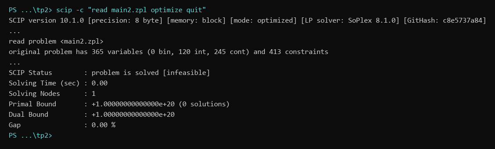
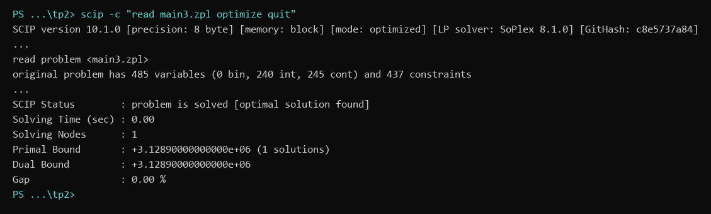
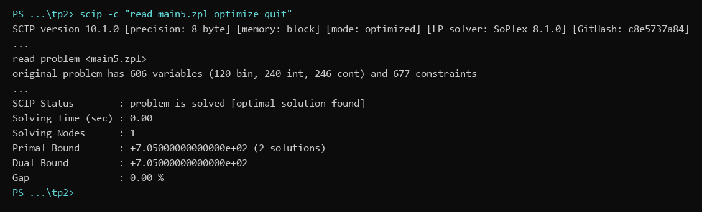

<div class="caratula" align="center">


<p class="materia">Aplicaciones Computacionales en Negocios</p>

<h1 class="titulo">Trabajo Práctico 2</h1>

<p class="subtitulo">Modelo de <em>lot sizing</em> para planificación de producción</p>

<p class="dato"><strong>Grupo:</strong><br>Felipe Vilaseca Navajas<br>Manuel Ferrario</p>

<p class="dato"><strong>Profesor:</strong> Javier Marenco</p>

<p class="dato">2do semestre 2026</p>

</div>

<div class="salto"></div>

## 1. Introducción

El enunciado pide planificar, mes a mes y durante un horizonte de 24 meses (enero
2027 a diciembre 2028), la producción de cinco productos ($A, B, C, D, E$) de forma
de cubrir una demanda estimada minimizando el costo total de fabricación. La
planificación está sujeta a capacidad de producción, a que la fabricación se hace
en lotes de 10 unidades, a una capacidad de depósito compartida entre productos y a
que no hay stock inicial.

Resolvemos cada punto planteando un modelo de programación lineal entera mixta
en **ZIMPL** y resolviéndolo con el solver **SCIP**. Cada inciso agrega
variables y/o restricciones al modelo anterior, por lo que preferimos mantener un
archivo `.zpl` por inciso (`main1.zpl` hasta `main5.zpl`) en lugar de parametrizar un
único archivo. Todos comparten los mismos datos de demanda (`demanda.csv`).

---

## 2. Datos

El Excel original (`tp2.2026.xlsx`) tiene la demanda en formato ancho: una fila
por mes y una columna por producto. ZIMPL necesita leerla en formato largo, una
fila por combinación (mes, producto) con su valor de demanda. Convertimos la
tabla a `demanda.csv`, con columnas `mes,producto,demanda`, numerando los meses
del 1 (enero 2027) al 24 (diciembre 2028).

---

## 3. Análisis de la demanda

La demanda tiene una marcada estacionalidad **anual** (el patrón de los 12 meses de 2027 se repite idéntico en
2028):

| | Ene | Feb | Mar | Abr | May | Jun | Jul | Ago | Sep | Oct | Nov | Dic |
|---|---|---|---|---|---|---|---|---|---|---|---|---|
| Demanda total (A+B+C+D+E) | 90 | 115 | 125 | 150 | 295 | 460 | **735** | **850** | 620 | 250 | 145 | 90 |

- **Demanda total del horizonte:** 7.850 unidades (1.850 A, 2.280 B, 930 C, 1.140 D,
  1.650 E).
- **Pico de demanda:** agosto, con 850 unidades/mes contra las demás, muy por
  encima del promedio mensual (≈327).
- Los meses de julio-septiembre concentran una demanda mucho mayor que la
  capacidad instalada sin tercerizar ($5 \times 120 = 600$ unidades/mes): solo
  para satisfacer agosto "de contado" faltarían 250 unidades, que deben haberse
  producido y almacenado en meses anteriores.
- Esta estacionalidad es la razón de ser del stock: el depósito existe
  precisamente para desacoplar la producción (limitada mes a mes) de una demanda
  muy desigual en el tiempo.
- Es también la causa de la infactibilidad del inciso 2 (ver sección 6.2): la
  demanda acumulada hasta agosto (2.820 unidades) ya supera la capacidad de
  producción acumulada hasta agosto con el límite de 300 u./mes (2.400 unidades,
  sin siquiera considerar la restricción de depósito), por lo que ningún plan de
  producción puede alcanzar a cubrirla.

---

## 4. Formulación general del problema

Usamos la siguiente notación en todos los incisos; cada uno agrega lo que necesite
sobre esta base común.

**Conjuntos**

- $T = \{1, \dots, 24\}$: meses de planificación.
- $P = \{A, B, C, D, E\}$: productos.

**Parámetros**

- $d_{t,p}$: demanda estimada del producto $p$ en el mes $t$ (dato, Tabla 1 /
  `demanda.csv`).
- $c = 370$: costo de producir una unidad de cualquier producto.

**Variables (modelo base, inciso 1)**

- $x_{t,p} \geq 0$: unidades producidas del producto $p$ en el mes $t$.
- $y_{t,p} \in \{0, 1, \dots, 12\} \subset \mathbb{Z}$: cantidad de lotes de 10
  unidades producidos de $p$ en $t$ (liga a $x_{t,p}$ mediante
  $x_{t,p} = 10\, y_{t,p}$, que es la forma más simple de forzar que $x_{t,p}$ sea
  múltiplo de 10 sin declarar a $x$ como entera).
- $s_{t,p} \geq 0$, con $t \in \{0, \dots, 24\}$: stock del producto $p$ al final
  del mes $t$ ($s_{0,p}$ es el stock inicial).

**Función objetivo (inciso 1)**

$$\min \; \sum_{t \in T} \sum_{p \in P} c \cdot x_{t,p}$$

**Restricciones (inciso 1)**

$$0 \leq x_{t,p} \leq 120 \qquad \forall t \in T,\, p \in P $$

*(capacidad de producción)*

$$x_{t,p} = 10\, y_{t,p} \qquad \forall t \in T,\, p \in P $$

*(lotes de 10)*

$$s_{0,p} = 0 \qquad \forall p \in P $$

*(sin stock inicial: stock inicial = 0)*

$$s_{t,p} = s_{t-1,p} + x_{t,p} - d_{t,p} \qquad \forall t \in T,\, p \in P $$

*(balance de stock: define el stock de cada mes y asegura que se cubra la demanda)*

Definimos $s$ también para $t = 0$ para que el balance del primer mes pueda usar
$s_{0,p}$, que vale 0 por la restricción anterior.

$$\sum_{p \in P} s_{t,p} \leq 900 \qquad \forall t \in T $$

*(capacidad de depósito)*

La restricción de balance, junto con $s_{t,p} \geq 0$, es la que obliga a cumplir
toda la demanda en tiempo y forma: si en algún mes no se produce ni hay stock
suficiente para cubrir $d_{t,p}$, $s_{t,p}$ debería ser negativo, lo cual está
prohibido. Por lo tanto la demanda nunca se satisface "a crédito" ni se pierde
venta: el modelo es infactible si no alcanza a cubrirla.

---

## 5. Supuestos de modelado

- $x_{t,p}$ es continua y $y_{t,p}$ entera, con $x_{t,p} = 10\,y_{t,p}$, para
  forzar que la producción sea múltiplo de 10.
- La capacidad de depósito (900) es agregada entre los cinco productos:
  $\sum_p s_{t,p} \leq 900$.
- Toda la demanda se cubre en el mes que corresponde, sin excepciones; no
  exigimos que el stock final ($t=24$) sea 0.
- La tercerización ($z_{t,p}$) es entera, pero no está restringida a múltiplos
  de 10.
- Para "si se terceriza, mínimo 20 unidades" (inciso 4) usamos la binaria
  $w_{t,p}$ con $20\,w_{t,p} \leq z_{t,p} \leq 200\,w_{t,p}$.
- En el inciso 5, la capacidad de depósito pasa a ser una variable $K$ a
  minimizar, en lugar de buscarla a mano probando distintos valores.

---

## 6. Desarrollo inciso a inciso

### 6.1. Inciso 1 — Modelo base (`main1.zpl`)

Formulación: la de la sección 4.

**Resultado:** SCIP encuentra el óptimo en \$2.904.500. Este valor coincide
exactamente con la cota inferior teórica $c \cdot \sum_{t,p} d_{t,p} = 370 \times
7.850 = 2.904.500$: como la demanda total de cada producto a lo largo de los 24
meses es múltiplo de 10 (1.850, 2.280, 930, 1.140 y 1.650 unidades), es posible
producir exactamente la demanda total —ni una unidad más— usando lotes de 10 y
respetando la capacidad de depósito y de producción, simplemente adelantando
producción en los meses de baja demanda para cubrir los picos de mitad de año. El
modelo base es, entonces, factible y óptimo sin necesidad de producir de más.


### 6.2. Inciso 2 — Límite de producción total de 300 u./mes (`main2.zpl`)

Se agrega una única restricción al modelo base, que limita la producción
conjunta de los cinco productos en cada mes:

$$\sum_{p \in P} x_{t,p} \leq 300 \qquad \forall t \in T $$

*(producción máxima total)*

**¿Se puede cumplir la demanda total?** No. El modelo resulta **infactible**.
Alcanza con mirar la demanda acumulada: hasta agosto (mes 8) la demanda total
acumulada es de 2.820 unidades, mientras que la capacidad de producción acumulada
con el límite de 300 u./mes es de apenas 2.400 unidades. Ningún plan de
producción —sin importar cómo se distribuya el stock— puede cubrir ese déficit de
420 unidades, porque toda la demanda debe cubrirse en su propio mes. El déficit
acumulado nunca se recupera: a diciembre de 2028 (mes 24) sigue siendo de 650
unidades. SCIP confirma
esto devolviendo estado de infactibilidad (`infeasible`) al resolver `main2.zpl`.



### 6.3. Inciso 3 — Tercerización de hasta 200 u./mes a \$540 (`main3.zpl`)

Se agregan la variable $z_{t,p} \geq 0$ (entera) con costo $c_z = 540$, y se
modifica el balance de stock para que la tercerización también reponga stock:

$$\min \; \sum_{t \in T} \sum_{p \in P} \big(c \cdot x_{t,p} + c_z \cdot z_{t,p}\big)$$

$$s_{t,p} = s_{t-1,p} + x_{t,p} + z_{t,p} - d_{t,p} \qquad \forall t \in T,\, p \in P $$

*(balance de stock, modificado)*

$$\sum_{p \in P} z_{t,p} \leq 200 \qquad \forall t \in T $$

*(tercerización máxima)*

junto con la restricción de producción total de 300 u./mes del inciso 2 (que el
enunciado mantiene) y el resto de las restricciones del modelo base.

Con esta capacidad adicional, la producción propia más tercerizada alcanza 500
u./mes, que combinada con el stock acumulado en los meses de baja demanda sí
permite cumplir toda la demanda del horizonte.

**Resultado:** SCIP encuentra el óptimo en \$3.128.900: \$224.400 (≈7,7%) más
que el modelo base. De las 7.850 unidades demandadas, 1.320 terminan
tercerizándose (al costo mayor de \$540) y el resto se produce internamente; esa
combinación es la que minimiza el costo total sujeto al tope conjunto de 300
u./mes de producción propia.



### 6.4. Inciso 4 — Mínimo de 20 u. por pedido tercerizado (`main4.zpl`)

Se agrega la variable binaria $w_{t,p}$ (vale 1 si se tercerizó el producto $p$ en
el mes $t$) y dos restricciones tipo big-M que la ligan a $z_{t,p}$:

$$z_{t,p} \geq 20\, w_{t,p} \qquad \forall t \in T,\, p \in P $$

*(mínimo de tercerización)*

$$z_{t,p} \leq 200\, w_{t,p} \qquad \forall t \in T,\, p \in P $$

*(tercerización activa)*

La primera obliga a que, si $w_{t,p}=1$, se tercericen al menos 20 unidades; la
segunda obliga a que, si no se tercerizó ($w_{t,p}=0$), $z_{t,p}$ sea 0 (y, si se
tercerizó, no deja que $z_{t,p}$ supere la cota del problema, 200, con lo cual la
cota es válida sin restringir de más).

**¿Cómo cambia el costo total?** No cambia: el óptimo sigue siendo \$3.128.900,
idéntico al del inciso 3, y el volumen total tercerizado también es el mismo
(1.320 unidades). Esto no es porque la restricción sea irrelevante, sino porque
el problema del inciso 3 tiene **múltiples soluciones óptimas alternativas** con
el mismo costo: la solución que encontró SCIP para `main3.zpl` incluye 10 pedidos
tercerizados de menos de 20 unidades (por ejemplo, 5 unidades de $E$ en el mes 1),
pero existe otra combinación de lotes —con exactamente el mismo costo total—
donde cada pedido tercerizado que se realiza es de 20 unidades o más. Al
resolver `main4.zpl`, SCIP encuentra el mismo óptimo: la restricción no cambia
la resolución del problema en términos de costo, solo selecciona una de las
soluciones óptimas que ya existían.


### 6.5. Inciso 5 — Mínima capacidad de depósito factible (`main5.zpl`)

En vez de buscar manualmente (por búsqueda binaria) el menor $K$ para el cual el
modelo del inciso 4 sigue siendo factible, lo incorporamos como variable de
decisión: reemplazamos la cota fija de depósito (900) por una variable
$K \geq 0$, cambiamos la función objetivo a minimizar $K$, y dejamos el resto del
modelo (incluida la tercerización con mínimo de 20 unidades) igual que en el
inciso 4:

$$\min \; K$$

$$\sum_{p \in P} s_{t,p} \leq K \qquad \forall t \in T $$

*(capacidad de depósito, variable)*

Convertir una capacidad en variable de decisión es una idea que tomamos de los
modelos de *facility location* vistos en clase, donde la capacidad (o la
apertura) de una instalación es parte de lo que decide el modelo.

Esto es preferible a la búsqueda binaria manual porque **ya es en sí mismo un
problema de optimización lineal entera mixta**: en una sola resolución, SCIP
encuentra el valor de $K$ más chico compatible con todas las demás restricciones,
en lugar de tener que resolver el modelo del inciso 4 una y otra vez para
distintos valores fijos de capacidad hasta encontrar el límite por aproximaciones
sucesivas.

**Resultado:** $K_{\min} = 705$ unidades. Es decir, manteniendo las reglas de
producción, tercerización y mínimo de pedido del inciso 4, el depósito podría
reducirse de 900 a 705 unidades (un 21,7% menos) sin que el problema deje de ser
factible. Hay que tener en cuenta que el objetivo de este modelo es
exclusivamente encontrar la mínima capacidad: no minimiza el costo de
producción, así que este resultado no dice cuánto costaría el plan con un
depósito de 705 unidades.



---

## 7. Tabla comparativa de resultados

| Inciso | Variante | Costo total óptimo | Observaciones |
|---|---|---|---|
| 1 | Modelo base | \$2.904.500 | Coincide con la cota teórica $370 \times 7.850$; no se produce ninguna unidad de más |
| 2 | Tope de 300 u./mes | Infactible | La demanda acumulada supera la capacidad acumulada a partir de agosto |
| 3 | + Tercerización (≤200 u./mes, \$540) | \$3.128.900 | 1.320 u. tercerizadas (+7,7% vs. inciso 1) |
| 4 | + Mínimo de 20 u. por pedido tercerizado | \$3.128.900 | Sin cambio vs. inciso 3: hay múltiples óptimos y uno ya cumple la cota mínima |
| 5 | Mínima capacidad de depósito factible | — | $K_{\min} = 705$ u. (−21,7% vs. 900) |

---

## 8. Cómo ejecutar los modelos

**Requisitos:** [SCIP](https://scipopt.org/) con soporte para leer modelos
**ZIMPL** (`.zpl`) directamente. La SCIP Optimization Suite (por ejemplo, el
instalador para Windows) ya incluye ZIMPL. En macOS, el paquete de Homebrew no
trae ese lector; ahí se puede instalar desde `conda-forge`:

```bash
conda create -n tp2scip -c conda-forge scip zimpl
conda activate tp2scip
```

**Archivos entregados:**

- `tp2.2026.xlsx`: demanda original, tal como la provee la cátedra.
- `demanda.csv`: demanda en formato largo, como la leen los modelos ZIMPL.
- `main1.zpl` … `main5.zpl`: un modelo ZIMPL por inciso.

**Para correr cualquier inciso** (parado en la carpeta del proyecto, con
`demanda.csv` presente):

```bash
scip -c "read mainN.zpl optimize display solution quit"
```

reemplazando `mainN.zpl` por el archivo del inciso que se quiera correr. SCIP
imprime el estado de la resolución (óptimo / infactible), el valor objetivo
(`objective value: ...`) y, con `display solution`, el valor de cada variable.

---

## 9. Conclusión

El modelo base (inciso 1) logra cumplir toda la demanda del horizonte produciendo
exactamente lo necesario, sin desperdicio: el costo óptimo de \$2.904.500
coincide con la cota teórica de costo de producción, usando el depósito para
desacoplar la producción (acotada mes a mes) de una demanda fuertemente
estacional. Esa misma estacionalidad es la que vuelve infactible el límite de
producción de 300 u./mes del inciso 2: a partir de agosto la capacidad acumulada
ya no alcanza para cubrir la demanda acumulada, y ningún plan de producción
—por más que anticipe stock— puede revertir ese déficit.

La tercerización (inciso 3) resuelve esa infactibilidad al costo de un 7,7% más
que el óptimo teórico, tercerizando 1.320 de las 7.850 unidades totales. Exigir
un mínimo de 20 unidades por pedido tercerizado (inciso 4) no encarece la
planificación: SCIP encuentra el mismo óptimo, porque el problema tiene múltiples
soluciones óptimas con el mismo costo y alcanza con elegir la que ya respeta esa
cota mínima.

Finalmente, la capacidad de depósito de 900 unidades que fija el enunciado resulta
holgada: planteando la capacidad como variable a minimizar (inciso 5), en lugar de
probarla "a mano" con búsqueda binaria, encontramos que con 705 unidades el
problema sigue siendo factible con las mismas reglas de producción y
tercerización, una reducción del 21,7% en el espacio de depósito necesario.
